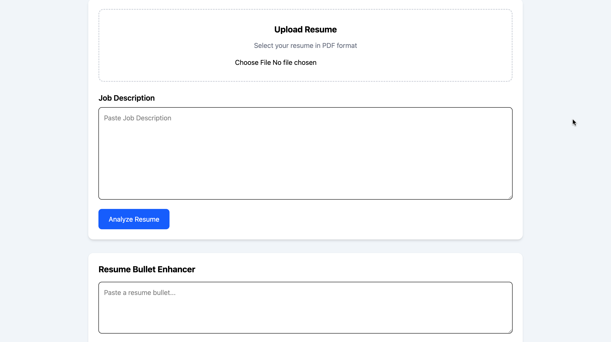
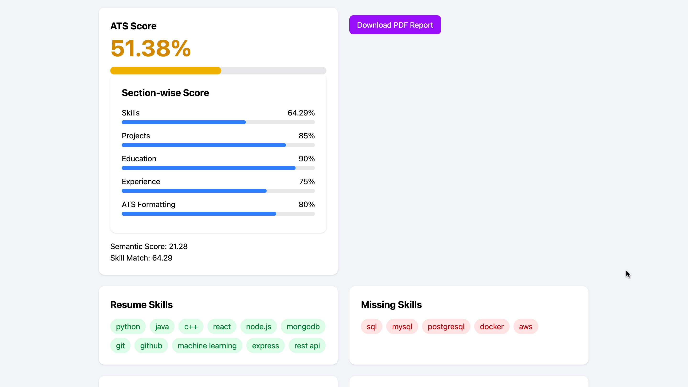
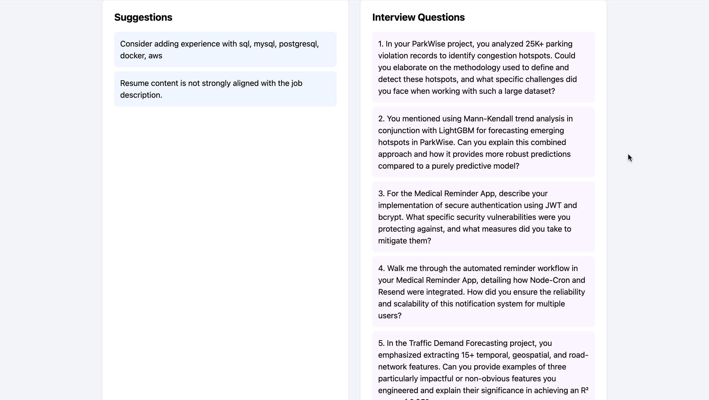
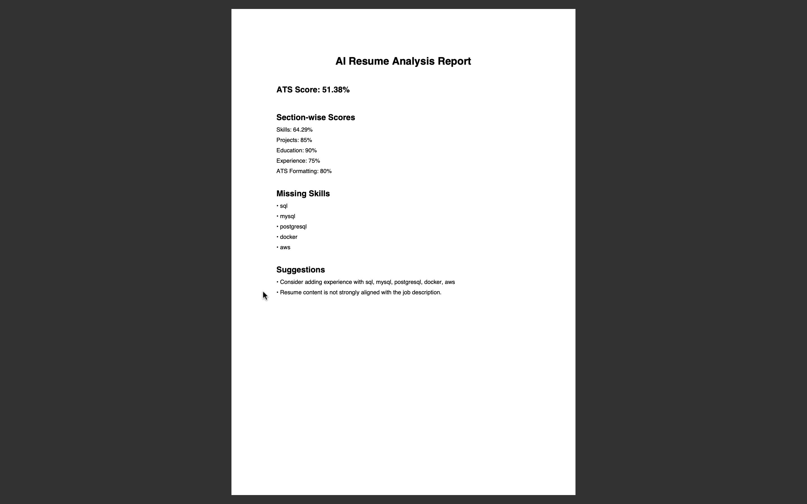
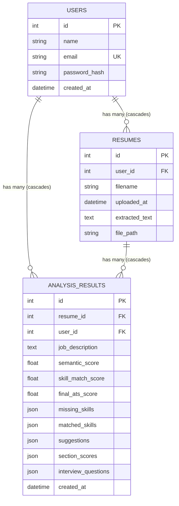

# AI Resume Analyzer

An AI-powered Resume Analyzer that evaluates resume–job description alignment, generates ATS compatibility scores, identifies missing skills, and provides personalized improvement recommendations using NLP, Sentence Transformers, and Large Language Models.

<<<<<<< HEAD
## 📸Screenshots
=======
---

## 📸 Screenshots
>>>>>>> 9e4ab8b (added auth, security)

| Home | ATS Analysis |
|------|--------------|
|  |  |

<<<<<<< HEAD
| Suggestions | PDF Report |
|------|--------------|
|  |  |
=======
### PDF Report

>>>>>>> 9e4ab8b (added auth, security)

---

## 🌟 Upgraded Enterprise Architecture & Key Features

### 1. PostgreSQL Database & SQLAlchemy ORM
* **Users Table**: Secure user management with unique email index, bcrypt password hashing, and created timestamp.
* **Resumes Table**: Stored resumes with user foreign keys, original filenames, secure UUID file references, extracted text, and cascading deletion.
* **AnalysisResults Table**: Comprehensive audit trail storing job descriptions, semantic scores, skill match scores, final ATS scores, section scores, missing/matched skills, suggestions, and interview questions.
* **Database Migrations**: Managed via **Alembic** for reproducible, version-controlled schema evolution.

### 2. JWT Authentication & HttpOnly Cookie Security
* Passwords hashed using industry-standard **bcrypt** (12 salt rounds).
* Stateless **JWT Access Tokens** containing user ID and expiration claims without sensitive credentials.
* Token transport via secure **HttpOnly, SameSite cookies** with fallback support for `Authorization: Bearer <token>` headers.
* Standardized endpoints:
  - `POST /auth/register`
  - `POST /auth/login`
  - `POST /auth/logout`
  - `GET /auth/me`

### 3. Ownership-Based Authorization
* Strict ownership enforcement on every protected resource.
* Users can only access, re-analyze, download reports for, or delete their own resumes and analysis results.
* Returns `HTTP 401 Unauthorized` for missing/expired credentials.
* Returns `HTTP 403 Forbidden` if an authenticated user attempts to access resources belonging to another user.

### 4. Secure Resume & Report Management
* **Strict File Validation**: Enforces PDF format via file extension, MIME type, and `%PDF-` magic byte inspection.
* **File Size Validation**: Enforces configurable maximum file size limit (10MB).
* **Path Traversal Protection**: Uses sanitized display filenames and UUID-based secure physical storage outside web root.
* **Re-Analysis**: Re-analyze any previously uploaded resume against new Job Descriptions with a single click.
* **Analysis History & Reports**: View analysis history and download dedicated PDF reports for any specific analysis.

### 5. Improved Analysis & Scoring Engine
* **Semantic Resume Matching**: Powered by Sentence Transformers (`all-MiniLM-L6-v2`) and cosine similarity.
* **Long Text Handling & Chunking**: To prevent silent token truncation beyond the model's 256-token limit, long resumes and JDs are split into overlapping 150-word windows (40-word overlap). Chunk embeddings are mean-pooled and L2-normalized back to unit space.
* **Deterministic ATS Scoring Formula**: Preserves the exact 70% skill match + 30% semantic score formula:
  $$\text{Final ATS Score} = \text{round}(0.7 \times \text{Skill Match Score} + 0.3 \times \text{Semantic Score}, 2)$$
* **Safe Empty JD Handling**: Handles empty skill lists gracefully without `ZeroDivisionError`.
* **Modular Skill Extraction**: Extensible `SkillExtractor` architecture preserving predefined skills.
* **Gemini LLM Integration**: Generative interview question generation and bullet enhancement.

---

## 🛠️ Tech Stack

### Frontend
* **React.js** (Vite)
* **Tailwind CSS**
* **Axios** (with credentials support for HttpOnly cookies)

### Backend
* **FastAPI** (Python 3.13)
* **SQLAlchemy ORM**
* **PostgreSQL** & **psycopg** / **psycopg2**
* **Alembic** (Database Migrations)
* **PyJWT** & **Bcrypt**

### AI & NLP
* **Sentence Transformers** (`all-MiniLM-L6-v2`)
* **Scikit-learn** (Cosine Similarity)
* **Google Gemini API** (`gemini-2.5-flash`)

### Document Processing
* **PDFPlumber**
* **ReportLab**

---

## 🗄️ Database Schema & Relationships



---

## 🚀 Installation & Setup

### 1. Prerequisites
* Python 3.10+ (tested on Python 3.13)
* Node.js 18+ and npm
* PostgreSQL (v14+) running locally or accessible via network

### 2. Clone Repository
```bash
git clone https://github.com/dyumna11/ai-resume-analyzer.git
cd ai-resume-analyzer
```

### 3. Database Setup
Create a PostgreSQL database:
```bash
psql -U postgres -c "CREATE DATABASE resume_analyzer;"
```

### 4. Backend Setup
Navigate to `ml-service/`:
```bash
cd ml-service

# Create and activate virtual environment
python3 -m venv venv
source venv/bin/activate  # On Windows: venv\Scripts\activate

# Install dependencies
pip install -r requirements.txt

# Configure environment variables
cp .env.example .env
# Edit .env and configure your DATABASE_URL, JWT_SECRET_KEY, and GEMINI_API_KEY

# Run database migrations
alembic upgrade head

# Start FastAPI server
uvicorn main:app --reload --host 127.0.0.1 --port 8000
```

### 5. Frontend Setup
In a new terminal window:
```bash
cd frontend

# Install npm packages
npm install

# Start Vite dev server
npm run dev
```
Open `http://localhost:5173` in your browser.

---

## 🧪 Testing

Run the automated backend test suite covering authentication, authorization, ownership isolation, PDF validation, re-analysis, and scoring:
```bash
cd ml-service
python test_backend.py
python test_scoring.py
```

---

## 🔑 Environment Variables Reference

| Variable | Description | Default |
|---|---|---|
| `DATABASE_URL` | PostgreSQL connection string | `postgresql://localhost:5432/resume_analyzer` |
| `JWT_SECRET_KEY` | Secret key used to sign JWT tokens | Configurable in `.env` |
| `JWT_ALGORITHM` | JWT signing algorithm | `HS256` |
| `ACCESS_TOKEN_EXPIRE_MINUTES` | Token lifetime in minutes | `1440` (24 hours) |
| `COOKIE_SECURE` | Set `True` when running under HTTPS | `False` |
| `COOKIE_SAMESITE` | Cookie SameSite policy | `lax` |
| `GEMINI_API_KEY` | Google Gemini API Key | Required for AI generation |
| `CORS_ORIGINS` | Allowed frontend origins (comma-separated) | `http://localhost:5173,http://127.0.0.1:5173` |

---

## 📄 License
ISC License
